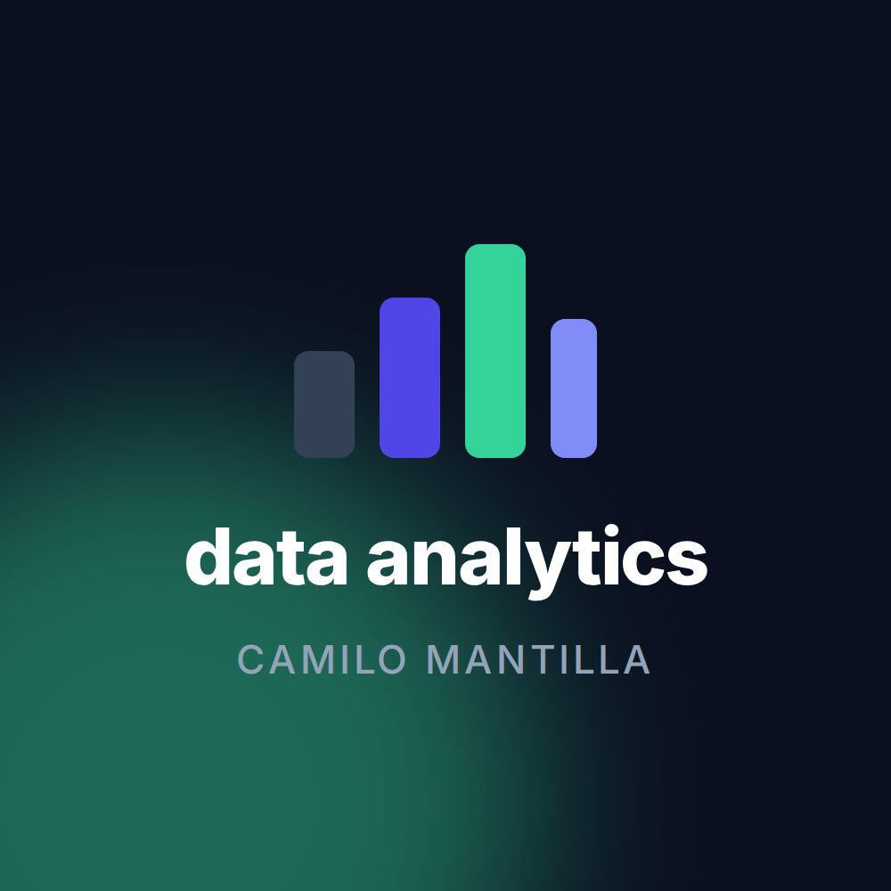

" alt="Camilo Mantilla · Ad Operations · Data · Automation" width="100%">

### Hi, I'm Camilo 👋

I work in **Ad Operations**, where every campaign goes through traffic
sheets, ad servers and a lot of manual checking. I started automating the
parts that don't need a human, and found out how much I enjoy building.

- 🛠️ I build internal tools with **Python** and **Streamlit**, and automations with **Google Apps Script**
- 📊 I analyse data with **pandas** and **Excel** to answer real operational questions
- 🤖 I work **AI-assisted**: I design the logic from real cases and build it with an AI coding assistant
- 🌱 Learning now: software design, automated testing, and shipping tools a team can trust

## ⭐ Featured project

<table>
<tr>
<td width="38%">

</td>
<td>

**[QA2: automated second-pass QA for ad campaigns](https://github.com/camilo-apps/qa2-showcase)**

Reads the Traffic Sheet (colours included), compares it with what is
live in the ad server and delivers a signed report with the evidence.

⏱️ **≈5 min per decision set → 55 s per full request** (156 placements) 
🔎 Caught two crossed rotations that had passed two manual reviews 
✅ 31 validation rules · 660+ automated tests in production

`Python` `Streamlit` `openpyxl` `Playwright` `ReportLab`

</td>
</tr>
</table>

## 🗂️ Where my work lives

<table>
<tr>
<td align="center" width="96"></td>
<td><b><a href="https://github.com/camilo-data-analytics">Data analytics</a></b> Analysis projects: cleaning, exploring and explaining data to answer one clear question each.</td>
</tr>
<tr>
<td align="center" width="96"></td>
<td><b><a href="https://github.com/camilo-apps">Apps &amp; automation</a></b> Streamlit apps, Google Apps Script automations and tools like QA2.</td>
</tr>
</table>

## 🧰 Toolbox

## 📫 Let's connect

**[LinkedIn](https://www.linkedin.com/in/TU-USUARIO-DE-LINKEDIN)** · Spanish (native) · English
